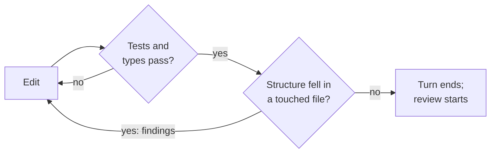

# Hold the structure, not just the behaviour

## Problem

The run added hold-back rules to the rollout planner. The tests passed, the diff was a single new
function, and the review took ten minutes. Four changes later, the same function decides seven
things, takes nine arguments, and nests five deep. Every change passed every check you run. They ask
whether the code works; the one linter rule that asked about shape was loosened the week it blocked
a legacy file. You find out when a two-line fix takes an afternoon, from you and from the agent,
which now spends most of its run reading the function before it touches it.

## The play

Measure what each change does to the structure, and give the result to the agent before the turn
ends, not to a reviewer afterwards.

1. **Score the change, not the codebase.** Run a structural delta over the files the run touched,
   against `HEAD`: complexity, nesting depth, argument count, duplication, each reported with a
   path and a line. A project-wide score averages new damage into old health and moves too slowly
   to see one change.
2. **Put it in the loop.** Report after each edit, and gate the end of the turn: if health fell,
   the run gets the findings and one more turn. CodeScene ships the check as an MCP server, which
   the agent calls when it thinks to: advice. `aihealth`, an open-source tool from this book's
   author, ships it as Claude Code hooks, which run either way. Even a hook narrows the options
   rather than removing them: the `aihealth` stop hook never fires twice in a row, so a run can
   still finish degraded.
3. **Ratchet, do not target.** Fail on any fall in a file the change touched, and hold new files to
   the healthy band, 9 or above on the 1–10 scale both tools use. A linter's complexity limit is a
   target: set tight, it blocks every change to a legacy file, so it gets loosened until it never
   fires.
4. **Keep the behaviour checks in front.** Run the structural check only after the suite and the
   type checker pass. A refactor that improves the score and changes behaviour is the worse result.
5. **Read the findings, not the number.** The score summarises; the smells with line numbers are
   what the agent fixes and what you review.



This works because structural decay arrives one passing step at a time, so only a check that
compares each step to the last can see it. The evidence is about what agents produce. A 2026 study
of 806 open-source projects that adopted Cursor in 2024 and early 2025 found code complexity up
41.6% and staying up, while the speed-up was gone after two months. The popular reason for caring,
that agents work better on healthy code, is the score vendor's own headline. Its own controlled
study, of refactoring single-file programs, found no significant difference for a frontier model or
for Claude Code ([`code-health.md`](../../../notes/research/code-health.md)). Agents do not need
clean code. The people who review and change it next do: in the same vendor's 2022 study of 39
proprietary codebases, the least healthy code took 124% longer to change. The exchange rate is an
extra turn on most changes, refactors you would have waved through, and a metric somebody must
calibrate and sometimes overrule.

## Worked example

`tideline`, a TypeScript service that stages firmware rollouts to field devices, needed hold-back
rules: a device is kept out of a stage for low battery, an unlisted model, a stale check-in, a
firmware gap, or a regional freeze. The team had the `aihealth` hooks in `.claude/settings.json`.
The stop half, as the tool's install guide gives it:

```json
{
  "hooks": {
    "Stop": [
      { "hooks": [{ "type": "command",
          "command": "command -v aihealth >/dev/null 2>&1 && aihealth hook stop || true" }] }
    ]
  }
}
```

The run's first pass was one function, `enrolDevice`, and the suite passed. Before the turn ended,
the hook ran the delta, and what came back became the run's next turn:

> Captured November 2026, aihealth 0.1.0 (commit `abfdd17`).

```text
$ aihealth delta; echo "exit $?"
aihealth delta: working tree vs HEAD: DEGRADED

  degraded  src/rollout/holdback.ts  new file, 7.89
    + new     L12    High Cognitive Complexity: enrolDevice has cognitive complexity 40
                     → Hard to follow: flatten with early returns/guard clauses and extract nested blocks.
    + new     L12    Complex Method: enrolDevice has cyclomatic complexity 25
    + new     L26    Bumpy Road: enrolDevice has 3 separate nested chunks (L26-32, L34-47, L62-72)
    + new     L12    Excess Arguments: enrolDevice takes 8 parameters (weighted 8)
    + new     L42    Deep Nesting: enrolDevice nests 4 levels deep at line 42
    + new     L59    Complex Conditional: enrolDevice has 1 complex boolean expression(s) (up to 2 operators: L59)
    # … one fix hint per finding, five omitted
exit 1
```

The project score at the same moment read healthy:

```text
$ aihealth scan .
…
project score: 9.64 (healthy)  (8 files, 405 LoC, LoC-weighted)
files: 7 healthy, 1 warning, 0 alert
…
```

The run replaced the eight arguments with one context object and the branches with five small rule
functions, checked in order. The suite still passed, and the delta came back clean:

```text
$ aihealth delta; echo "exit $?"
aihealth delta: working tree vs HEAD: UNCHANGED

  unchanged src/rollout/holdback.ts  new file, 10.00
exit 0
```

The check has a blind spot, and `tideline`'s history holds it. The cohort pull request a reviewer
had sent back the month before carried a second bucketing helper, rounding a boundary device the
opposite way to the first. On that branch, `src/cohort/` scores 10.00. The check measures shape, not
meaning, and two tidy functions that disagree are perfectly shaped.

## Failure mode

**The Healthy Average.** The dashboard is green, the trend line is flat, and the newest code is the
worst in the repository. A project score, including the headline number on both tools' dashboards,
weights each file by its size. In `tideline`, a 405-line service, one new function at 7.89 pulled
the project from 10.00 to 9.64, still labelled healthy. In a repository a hundred times larger, the
same function would not move the second decimal. The team watching the number sees stability while
the files the agent writes every day sit a band below the files nobody touches.

The tell is a project score that holds steady through a month of heavy agent work, beside a list of
the worst files that keeps gaining recent ones. The check that settles it is to score only the files
changed in the last month, and compare.

## Checklist

- [ ] A structural delta runs on every change, scoped to the files it touched
- [ ] The delta's findings reach the agent before its turn ends, not only the reviewer
- [ ] The gate fails on a fall in a touched file, not on an absolute project threshold
- [ ] New files are held to the healthy band
- [ ] The structural check runs after the suite and the type checker, never instead of them
- [ ] Recently changed files are scored separately from the project average

**See also:** [*Make the agent prove it*](make-the-agent-prove-it.md) ·
[*Review code you did not write*](review-code-you-did-not-write.md) ·
[*Collect and refine as a team*](../team/collect-and-refine-as-a-team.md)
